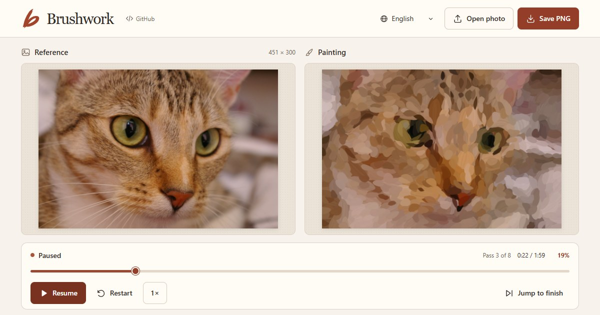

# Brushwork

Watch a photograph become a painting, one brushstroke at a time. Open your own photo and keep it next to the canvas while the painting takes shape.

[Try Brushwork in your browser](https://luzbel33.github.io/brushwork/)

Drag the timeline or tap anywhere on it to revisit a brushstroke. Playback resumes on release if it was running and stays paused if you paused it. With the slider focused, the arrow keys move five seconds, Shift + arrow moves one second, and Home and End take you to either end. You can also restart, change speed, or jump straight to the finished painting.

**Save PNG** pauses the playback at the instant you open it. **Save current frame** exports that canvas. **Save finished painting** exports the completed work, including strokes still waiting to play. Both PNGs contain only the painting. Closing the dialog returns you to your previous playback state.

On a phone, use the layout control beside **Reference** to switch between side-by-side and stacked images. Wide photos start stacked so the brushwork is easier to see.

## Run it

With Python 3 installed, run `python -m http.server 8000 --bind 127.0.0.1` in this directory and open [the local studio](http://127.0.0.1:8000). You can also host the directory on a static web host.

For a single file that opens with a double-click and works offline, run `python build.py`, then open `Brushwork.html`. Python is only needed to make the file. Use a browser with Canvas 2D and Web Workers.

English is the default. The language selector also offers Spanish, Simplified Chinese, Brazilian Portuguese and French. The browser remembers your selection on this device when local storage is available.

## How it paints

1. The browser reads the photo into memory, preserves its proportions and builds softened copies at different scales.
2. A Web Worker looks for changes in brightness between neighboring pixels. It estimates the direction of visible contours and uses those directions to guide the brushes.
3. Broad strokes establish the color masses. On later passes the worker compares the painting with the reference, placing smaller marks where the colors still differ. A seed derived from the photo makes the stroke sequence repeatable in the same browser.
4. Each mark stores its position, length, width, curve, color and brush texture. The player draws those marks at the chosen speed while a second canvas prepares the finished export. Browsers with OffscreenCanvas can paint it inside the worker. Other browsers paint it in short batches on the page so the controls stay responsive.

All photo processing takes place on the device. Running the painter requires no account, model download or paid API. New photos are analyzed at up to 1,050 pixels on the long edge and exported at up to 1,600 pixels, without upscaling smaller originals.

This project explores a long-standing graphics technique. Aaron Hertzmann published coarse-to-fine, contour-following strokes at SIGGRAPH in 1998. [NYU Media Research Laboratory, Painterly Rendering](https://mrl.cs.nyu.edu/projects/npr/painterly/)

## Source and sample

The canvas brush is in `brush.js`, the stroke planner is in `painting-worker.js`, and `timeline.js` reconstructs the canvas at a chosen moment. Playback and export are in `player.js`. The source code is available under the [MIT License](LICENSE).

The sample photograph of Chelsea the cat is by Stefan van der Walt, who released it under CC0. [scikit-image image credit](https://scikit-image.org/docs/stable/api/skimage.data.html#skimage.data.chelsea)
